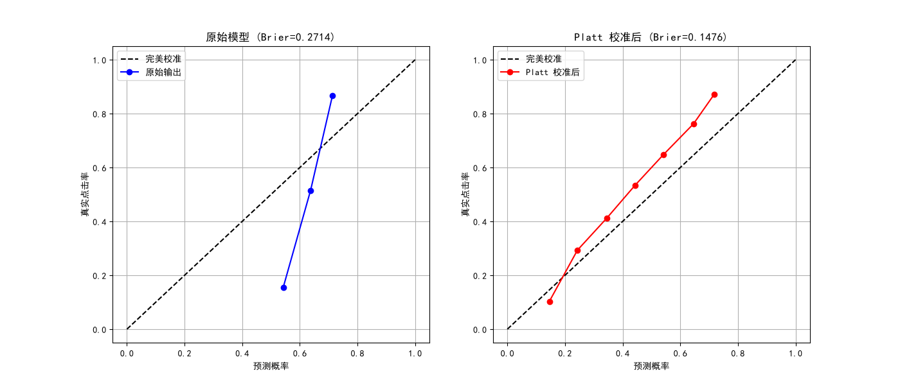
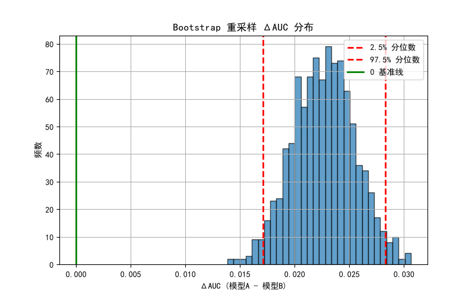
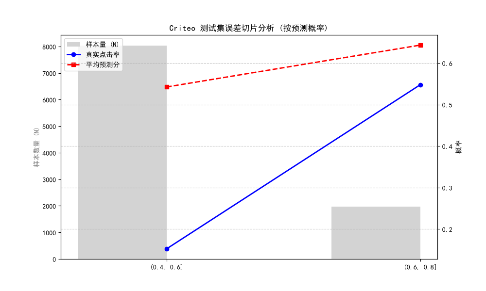

# Torch-RecHub 学习与实战：从基础排序到统计评估的完整链路

## 📖 项目简介
本项目基于开源推荐系统框架 `torch-rechub`，完成了一套工业级的推荐系统全链路实践。项目内容涵盖了**特征工程、CTR 预估模型（DeepFM/WideDeep/DIN）、多任务学习（MMoE/SharedBottom）、双塔召回与 Faiss 向量检索**，并在召回接排序（Recall-Rank）环节打通了完整链路。

作为本项目的最大特色，结合本人的**统计学专业背景**，我在传统的深度学习训练之外，引入了严格的统计推断与误差分析（**Calibration、Bootstrap 置信区间、Ablation Study 等**），量化了模型的真实业务价值与泛化误差，而不仅仅停留在“调包跑出一个 AUC”的层面。

## 🛠️ 核心技术栈与自建脚本
- **深度学习框架**：PyTorch, Torch-RecHub
- **向量检索**：Faiss (Flat, IVF, IP/L2 metric)
- **统计与评估库**：Scikit-learn (Calibration, LR), NumPy, SciPy
- **自建实验脚本**：包含在 `examples/ranking` 与 `examples/matching` 目录下的 `d01`~`d17` 系列脚本。

## 📊 核心实验结论与数据面板

### 1. 基础 CTR 预估与特征工程 (Criteo-100k)
- **数据流构建**：完成了从 CSV 数值离散化、LabelEncoder 编码、Embedding 映射到 DataLoader 打包的完整特征工程。深入源码对比了论文与原版 DeepFM 实现的差异（原实现中 DNN 分支未接入类别特征 Embedding，一阶分支作用于展平的 FM Embedding）。
- **基线对比**：
  | 模型 | 测试集 AUC | 备注 |
  | :--- | :--- | :--- |
  | WideDeep | 0.7360 | 基线模型 |
  | **DeepFM** | **0.7559** | 加入二阶交叉，验证了在 10 万行真实数据上的有效性 |

### 2. 序列推荐与注意力机制 (DIN)
- 针对 Amazon 数据集，引入了 Target Attention 机制，实现了历史行为序列对目标物品的局部激活。
- 深入解析了 `ActivationUnit` 的四块拼接逻辑及 Mask 处理机制。

### 3. 多任务学习 (MMoE vs SharedBottom)
- 在 Census 数据集上实现了多任务模型，对比了 MMoE 的专家门控（Gate）机制与 SharedBottom 的硬共享机制，复现了 MTLTrainer 的多任务 Loss 回传逻辑。

### 4. 召回与向量检索 (DSSM & Faiss)
- 基于 MovieLens-1M（约 100 万行真实数据）跑通了 DSSM 双塔模型（Recall@100 约 0.14）。
- **Faiss 索引优化与探究**：实现了从双塔召回 -> 过滤已交互历史 -> 拼接特征 -> 深度排序的完整 Demo (`d14_recall_rank.py`)。
- **索引对比实验**：通过实验量化了检索指标与延迟的权衡。由于双塔模型输出自带 L2 归一化，实验证明了此时 **Faiss 的 L2 距离与 IP 内积在数学上严格等价**。IVF 近似索引在损失约 6.6% 召回率的情况下，将检索耗时从 65ms 降至 16ms。

---

## 🔬 统计加深：模型评估与误差分析 (本项目最大亮点)

绝大多数推荐系统的复现仅停留在查看全局 AUC，但我利用统计学方法对模型进行了“深度体检”，相关脚本位于 `d15`~`d17`。

### 亮点一：模型校准 (Calibration) 与 Platt Scaling 修正
- **发现痛点**：在 DeepFM 模型（AUC=0.7849）上，我发现模型存在严重的**“过度自信”**。校准曲线显示，模型预测为 0.6 的样本，真实点击率仅为 0.1（Brier Score = 0.2714）。直接用于广告竞价（eCPM）会导致平台严重亏损。
- **解决方案**：在独立验证集上引入 **Platt Scaling（逻辑回归校准层）**，拟合概率映射斜率与截距。
- **结果**：在排序能力（AUC）保持不变的前提下，将 Brier Score 从 0.2714 显著降至 **0.1476**，实现了输出概率的完美纠偏。

### 亮点二：配对 Bootstrap 置信区间
- 针对传统 T 检验不适用于 AUC 复杂分布的痛点，采用了 1000 次**配对 Bootstrap (Paired Bootstrap)** 重采样。
- **做法**：构建差值 \(\Delta AUC\) 的经验分布，排除了抽样误差对模型评估的干扰。计算得出 \(\Delta AUC\) 的 95% 置信区间为 `[0.0171, 0.0283]`，不包含 0，从统计学角度证明了模型间的差异显著。

### 亮点三：消融实验 (Ablation Study)
- 为了证明 DeepFM 中 FM 模块的必要性，我通过前向传播时强制将 FM 分支置零，实现了模型消融。
- **结论**：移除 FM 二阶交叉后，AUC 从 **0.7744 骤降至 0.7523**（降幅 2.2%）。证实了在高度稀疏的 Criteo 数据上，显式特征交叉不可或缺。

### 亮点四：误差切片分析 (Error Analysis)
- 按预测概率分箱进行局部误差分析。发现模型预测极度挤压在 `(0.4, 0.6]` 和 `(0.6, 0.8]` 区间，且区间内部的局部 AUC（0.71 / 0.63）远低于全局 AUC。
- **业务启示**：模型在长尾或相似样本的细粒度区分上存在瓶颈，后续需引入更精细的特征交叉或重排策略。

---

## ⚠️ 避坑记录与局限反思
1. **数据集陷阱**：Criteo 数据集由于完全脱敏，缺乏 `user_id` 维度。因此只能采用“行独立”假设评估，且无法计算 GAUC。此外，全局 AUC 极易掩盖模型内部对重度/轻度用户的排序偏差。
2. **小样本的不稳定性**：在极小样本（如 32 条）下测试时，模型会因未收敛导致 AUC < 0.5，且 Calibration 完全失效。这验证了指标评估必须在万级别以上的数据集进行。
3. **负采样带来的概率偏差**：在使用负采样训练时，模型输出的分数比真实点击率高出数倍，必须通过公式 `p_true = p_sample / (p_sample + (1-p_sample)/r)` 进行修正校准。
4. **召回评估的未过滤问题**：在初始评估双塔召回时，发现未过滤历史交互物品导致 Recall 指标偏低。补充 Filter 过滤层后，召回接排序链路的业务逻辑才形成闭环。

## 📂 实验结果与脚本目录说明
- `scripts/`: 包含 CTR、多任务、校准、消融、双塔召回及 Faiss 测试等所有自建实验脚本 (`d01`~`d17`)。
- `d15_criteo/`, `d16_bootstrap/`, `d17_error_analysis/`: 存放模型预测明细 CSV 与统计图表。
- `images/`: 包含 README 中引用的核心可视化大图。